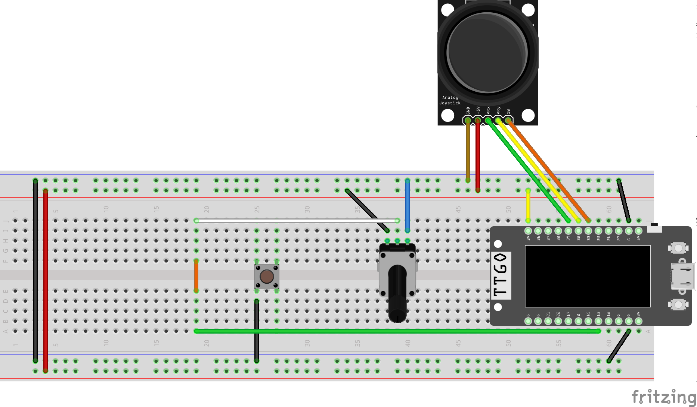
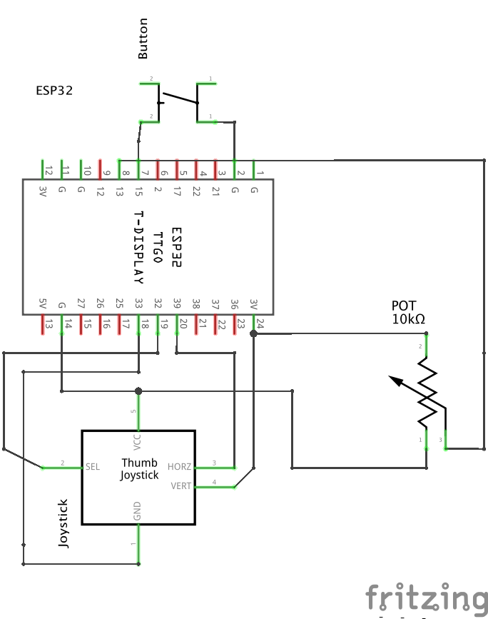

# coms3930-module-2: Interactive Device

For my interactive device, I made a task tracker using a pushbutton, a potentiometer, and a joystick connected to a ESP-TFT board.
On the Processing code, the list of tasks to be tracked is created and, based on the serial communication sent from the Arduino processing of the sensors' inputs, the status of each task can be updated to reflect its current state (X - completed, else empty for not yet completed) pressing the push button. To change the active task to be updated, the user controls the potentiometer's knob. Offering customisation to the user, the joystick's x-axis switches between available design themes. The y-axis on the joysticke offers a convenient way to reset all tasks to be uncompleted. 

Using just a breadboard and a laptop (to connect the ESP-TFT), you can connect the circuit elements as presented in the schematic below. The wiring connections are as follow:
- On the pushbutton:
  - Connected to 15
- On the potentiometer: 
  - Connected to 13
- On the joystick:
  - GND to GND
  - +5V to +3V power rail (this is to help normalize the readings from the potentiometer)
  - VRX (x-direction of joystick) to 39
  - VRY (y-direction of joystick) to 32
  - SW (switch when you press in on joystick) to 33 [ended up not using, but initially connected while designing) 



- If prefered, you can also follow the layout schematic of the circuit.

Be sure to upload both programs, but that the Arduino IDE is not using your board's port (which has to be used by Processing). 

## Code - Design Choices
### To change the tracked tasks
- In **Arduino** code, modify the constant ```NUM_TASKS``` found at the beginning of the program to your desired number of tasks to be tracked: ```const int NUM_TASKS = 3;  // Pre-defined # of tasks```
- In **Processing** code, modify the constant ```NUM_TASKS``` found at the beginning of the program to your desired number of tasks to be tracked ```int NUM_TASKS = 3;```

To actually change what are the tracked tasks, change the following String array in Processing:
```c++
String[] taskNames = {"Exercise", "Swift", "Reading"};
```

### To change the available themes
To change the design of the available themes, go to the end of the **Processing** code to find the functions that create the graphics for each (```drawMininimalistUI()``` - theme0, ```drawAestheticDashboard()``` - theme1). 
In this implementation, the design is created through a combination of mostly ```fill()``` (used to colour), ```rect()``` and ```text()```. You can either modify their parameters or use different methods in these functions to personalise the themes to your liking. 

### To change timing parameters
- ```const unsigned long themeCooldown = 350;```: determine the delay between x-axis movement to change the theme (default: 0.35s);
- ```const unsigned long resetHoldTime = 500;```: how long user has to hold joystick in y-axis direction to reset the tasks to uncompleted (default: 0.5s)
